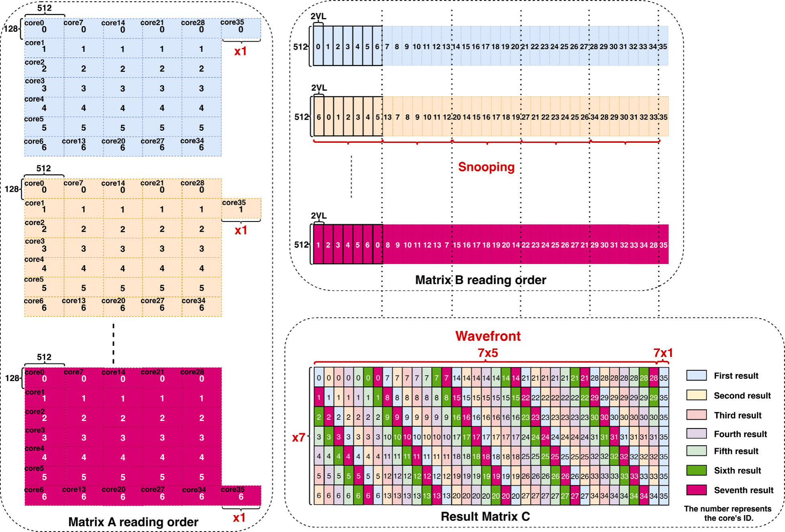
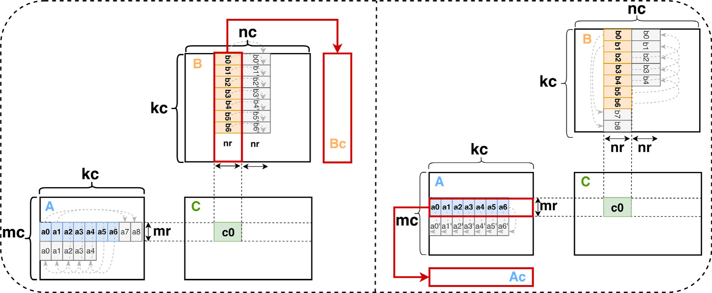
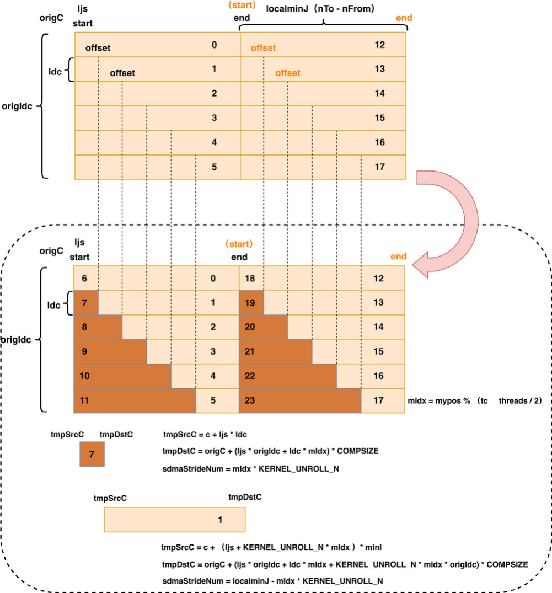
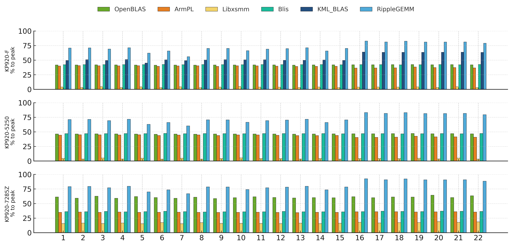
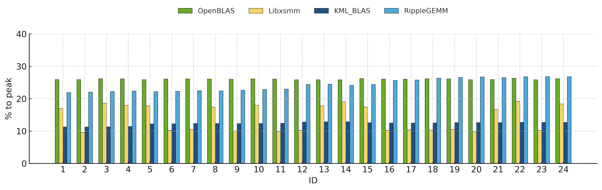

# CPU BLAS Performance Benchmarks

FP64 GEMM benchmark drivers, experiment datasets, and research figures for Kunpeng 920 CPUs, with archived AMD EPYC comparisons.

[Paper](https://doi.org/10.1016/j.sysarc.2026.103902) · [Build & run](docs/reproduction.md) · [Datasets](data/README.md) · [Validation](docs/validation.md)

This repository accompanies **RippleGEMM: Normalizing irregular DGEMM on CPUs via execution-layer optimization mechanisms**, published in *Journal of Systems Architecture*, 178 (2026), 103902. It provides the library benchmark drivers and experimental artifacts used to study irregular matrix shapes, memory access, and execution efficiency.

## What is included

| Component | Coverage |
| --- | --- |
| Library benchmarks | OpenBLAS, BLIS, Arm Performance Libraries, LIBXSMM, BLASFEO, and LibShalom |
| Workloads | FP64 GEMM with fixed `K = 384` / `K = 1920`, rectangular shapes, and partial tiles |
| Hardware probes | AArch64 NEON and SVE FMA throughput with OpenMP |
| Experimental data | 76 raw CSV files, 3 original workbooks, and HPL / LibShalom text outputs |
| Research figures | Wavefront scheduling, packing, offset bifurcation, and cross-platform comparisons |
| Reproduction metadata | Pinned library commits, source patches, compiler settings, environment captures, and file checksums |

The two server workspaces retain their original directory names under `benchmarks/`, so scripts and historical measurements remain traceable. Executable targets benchmark the libraries listed above; the method figures below describe the paper's execution mechanisms.

## Method context

**Wavefront scheduling.** Irregular slabs are organized into compute epochs so that matrix access and output placement remain structured when the dimensions do not divide evenly across a thread group.

<p align="center">
  
</p>

*Paper Figure 2: matrix access and result placement for an irregular M-direction slab.*

<details>
<summary><strong>Packing and offset bifurcation</strong></summary>

**Packing.** Panels of A and B are arranged according to the access and prefetch order used by the compute kernel.



*Paper Figure 4: access-aware packing of A and B into Ac and Bc.*

**Offset bifurcation.** Complementary offset ranges expose work within a thread group while preserving the logical output domain.

<p align="center">
  
</p>

*Paper Figure 6: right-matrix offsets and SIMD utilization within a thread group.*

[View the N-direction scheduling figure](picture/wavefront_n_tail.png).

</details>

## Quick start

### Requirements

- Linux with GCC / G++, GNU Make, Bash, and OpenMP.
- A BLAS library with CBLAS headers and libraries; SVE probes require an SVE-capable AArch64 CPU.
- Backend-specific dependencies are configured through Makefile variables. See [dependency setup](docs/reproduction.md).

### Build and run OpenBLAS

```bash
git clone https://github.com/XIAO1HAI/CPU_BLAS_Performtst.git
cd CPU_BLAS_Performtst

export OPENBLAS_ROOT=/opt/OpenBLAS
make -C benchmarks/kunpeng_blas/test-1023/Test_blas openblas \
   OPENBLAS_INC="$OPENBLAS_ROOT/include" \
   OPENBLAS_LIB="$OPENBLAS_ROOT/lib"

OMP_NUM_THREADS=2 OPENBLAS_NUM_THREADS=2 GOTO_NUM_THREADS=2 \
   benchmarks/kunpeng_blas/test-1023/Test_blas/dgemm_bench_openblas \
   --m 32 --n 48 --k 16 --layout row --transA N --transB T \
   --repeats 5 --warmup 1
```

The driver prints the matrix shape, layout, transpose mode, elapsed time, and GFLOP/s. Dimensions and repeat counts must be positive; warmup counts may be zero.

### Run a shape list

```bash
cd benchmarks/kunpeng_blas/test-1023/Test_blas
SHAPES_FILE=blis/shapes.csv OUT=openblas_36threads.csv \
  bash run_nt.sh openblas 36
```

`SHAPES_FILE` contains `M,N,K` rows. Without it, each runner uses its existing experiment shapes. New runs use timestamped filenames unless `OUT` is supplied. Historical measurements are stored separately in `data/`.

### Other backends

| Backend | Entry point | Interface |
| --- | --- | --- |
| BLIS | `benchmarks/test_1023/Test_blas/blis` | `M N K [warmup] [repeat]` |
| ARMPL | `benchmarks/test_1023/Test_blas/armpl` | `M N K [warmup] [repeat]` |
| LIBXSMM | `benchmarks/test_1023/Test_blas/libxsmm` | `M N K repeat [verify]` |
| BLASFEO | `benchmarks/kunpeng_blas/test-1023/Test_blas/blasfeo` | `M N K repeat warmup [threads] [N-slice]` |
| LibShalom | `benchmarks/kunpeng_blas/test-1023/Test_blas/shalom` | Named dimensions and thread count; NN GEMM |

Detailed build commands, source-tree library paths, and threading settings are in [the reproduction guide](docs/reproduction.md).

## Selected experimental results

The following figures are archived research results. They retain the original shapes, platform labels, and normalization used in the paper; they are independent of the small-matrix validation runs used to maintain this repository.



*Irregular K=1920 workloads on KP920-F, KP920-5250, and KP920-7285Z, comparing RippleGEMM with the evaluated BLAS libraries.*



*KP920-F with M=K=384 and 24 irregular N shapes: OpenBLAS, LIBXSMM, KML_BLAS, and RippleGEMM. Workload IDs follow paper Table 3.*

[Additional K=1920 comparisons](exp_result/) · [Raw library runs](data/library_runs/) · [Original comparison workbooks](data/workbooks/)

Measurements should be compared using the same shape, thread placement, and timing statistic. The archived drivers preserve their mean, minimum, or trimmed-mean timing conventions; the [dataset index](data/README.md) describes the available source collections.

## Repository layout

```text
benchmarks/
├── benchmark_args.h       # Shared argument and allocation checks
├── kunpeng_blas/          # KunPeng_BLAS workspace variants
└── test_1023/             # Second workspace and SVE-capable platform drivers
data/
├── library_runs/          # Library results organized by platform
├── experiment_exports/   # Additional exported measurements
└── workbooks/             # Original comparison workbooks
picture/                   # Method figures exported from the paper
exp_result/                # Original experimental-result figures
dependencies/              # Fixed revisions, patches, build settings, licenses
docs/                      # Reproduction, validation, environments, provenance
tests/                     # Local regression checks
```

## Validation

```bash
python3 -m unittest discover -s tests -v
```

These checks cover argument validation, shell syntax, environment setup, runner invocation, and numeric CSV output. Hardware checks compile and run the maintained drivers on the original Kunpeng servers; numerical reference checks and instruction-count evidence are recorded in [the validation report](docs/validation.md).

## Citation

```bibtex
@article{yang2026ripplegemm,
  title   = {RippleGEMM: Normalizing irregular DGEMM on CPUs via execution-layer optimization mechanisms},
  author  = {Yang, HaiBiao and Lu, Lu and Zhang, Yu and OuYang, HongJun and Chen, DongXian},
  journal = {Journal of Systems Architecture},
  volume  = {178},
  pages   = {103902},
  year    = {2026},
  doi     = {10.1016/j.sysarc.2026.103902}
}
```

## License

Repository code is distributed under the [MIT License](LICENSE). Third-party code retains its original licenses under `dependencies/*/licenses/`. Research figures and paper material retain their original attribution and rights.
